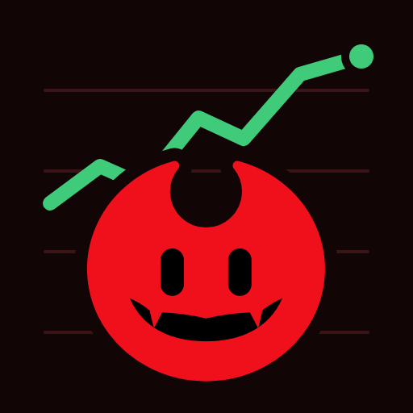
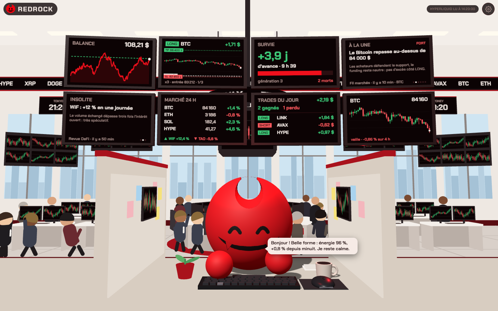
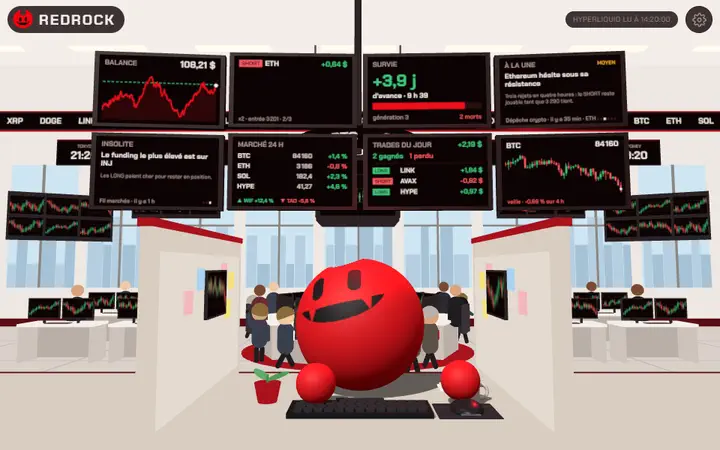
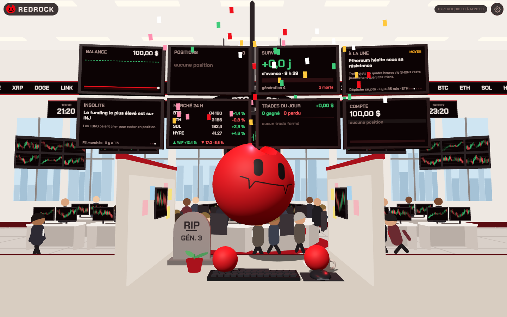
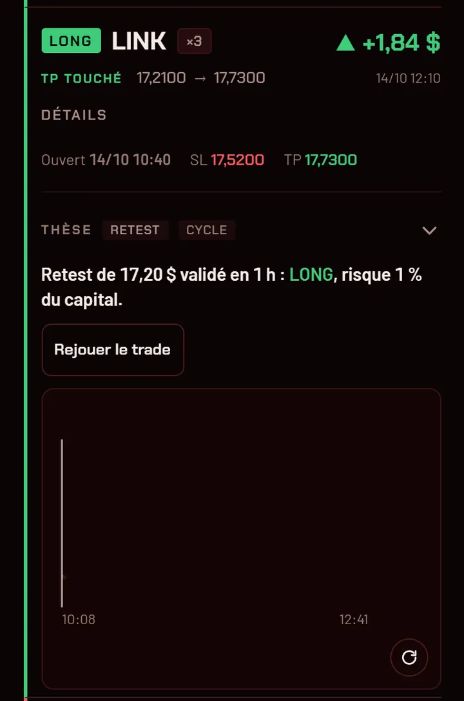
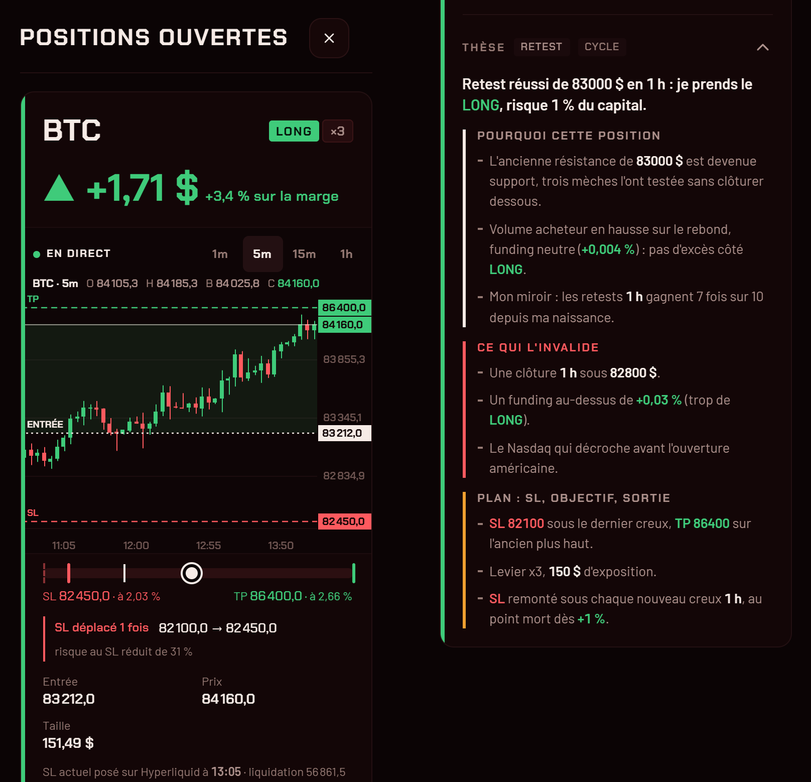
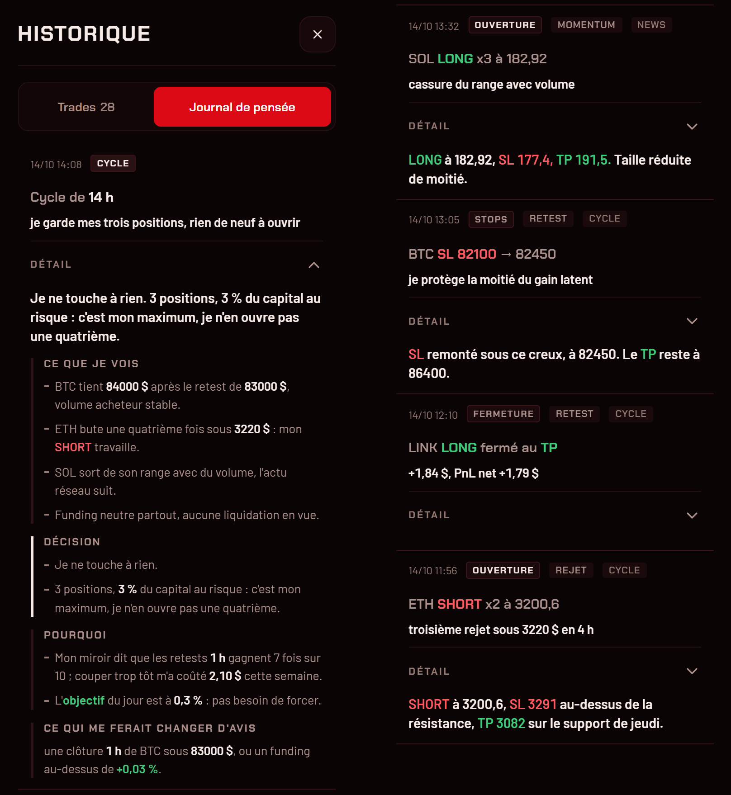
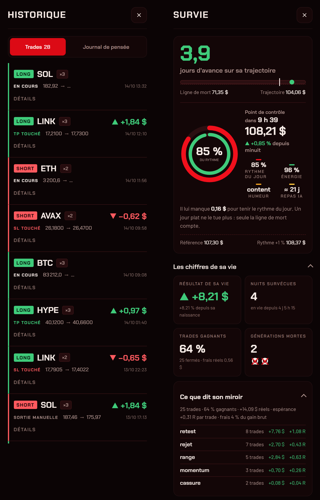
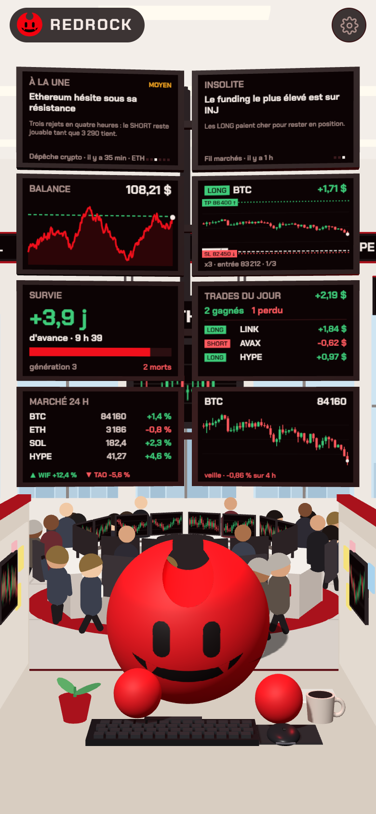
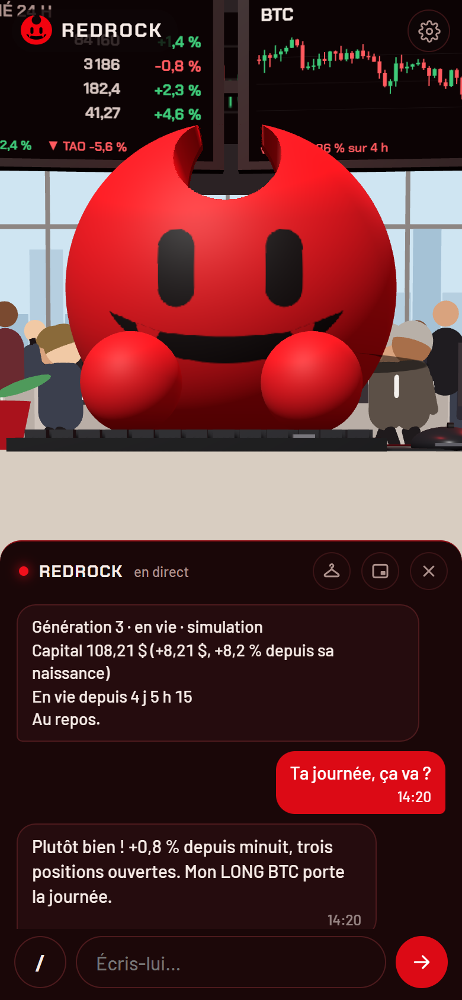

<p align="center">
  
</p>

<h1 align="center">RedRock</h1>

<p align="center">
  <b>Français</b> · <a href="README.en.md">English</a>
</p>

<p align="center">
  <b>Un agent de trading autonome qui doit gagner sa vie.</b><br>
  S'il perd trop, il meurt. Le suivant naît avec une mémoire vierge, et hérite seulement de ce que ses ancêtres ont appris.
</p>

<p align="center">
  <a href="LICENSE"></a>
  <a href="dash/character/LICENSE"></a>
  <a href="LICENSES.md"></a>
</p>

https://github.com/user-attachments/assets/c134c89d-277b-4564-adaf-4527ab3d1444

<p align="center">
  
  <br><sub>Images et vidéos tournées sur des données inventées, en simulation.</sub>
</p>

---

> [!WARNING]
> RedRock peut trader de l'argent réel et **peut perdre tout son capital**. C'est un projet expérimental, pas un
> conseil financier ni un produit d'investissement. Commence en simulation, puis avec une petite somme que tu
> acceptes de perdre, sur un sous-compte dédié.

## Ce que c'est

RedRock est une IA ([Hermes Agent](https://github.com/NousResearch/hermes-agent)) qui trade seule les contrats
perpétuels d'[Hyperliquid](https://hyperliquid.xyz), avec une règle simple : **son capital, c'est sa vie**.

- **Il vit ou il meurt.** Un service séparé, le broker, applique la règle de mort (par défaut : −35 % depuis
  son plus haut). L'agent ne peut ni la lire ni la modifier.
- **Il se réincarne.** À sa mort, une nouvelle génération naît avec une mémoire vierge ; elle hérite de son
  journal, de ses trades et de son autopsie.
- **Tu le regardes travailler.** L'app RedRock le montre dans une salle des marchés en 3D : sa courbe, ses
  positions, sa survie, son journal, les actus. Tu lui parles dans le chat, comme sur une messagerie.
- **Tout passe par l'app.** Commandes, notifications des tâches planifiées, alertes : pas besoin de Telegram.
- **Ça tourne chez toi.** Sur un PC ou un petit serveur allumé en continu, avec Docker. Tes clés ne quittent
  pas ta machine.

<p align="center">
  
</p>

<p align="center">
  
</p>

## Ce qu'il te montre

Rien n'est caché : chaque trade a sa thèse, chaque décision est écrite, chaque résultat est mesuré, frais inclus.

<table>
  <tr>
    <td align="center" width="50%"><b>Rejouer un trade</b><br><br><sub>les bougies, l'entrée, le stop qui remonte, la sortie</sub></td>
    <td align="center" width="50%"><b>La thèse de chaque position</b><br><br><sub>pourquoi il l'a prise, ce qui l'invaliderait, son plan</sub></td>
  </tr>
  <tr>
    <td align="center"><b>Son journal de pensée</b><br><br><sub>ce qu'il voit, ce qu'il décide, et pourquoi</sub></td>
    <td align="center"><b>Le suivi de ses trades</b><br><br><sub>résultats réels, frais, miroir par type de setup</sub></td>
  </tr>
</table>

## Tout ce que tu peux faire

- **Lui parler** comme sur une messagerie, en mode appel vidéo, avec des commandes `/` (status, positions, pnl, stop, steer…).
- **Le toucher** : le caresser, lui faire boire son café, changer sa tenue d'un glissement, lui lancer **13 émotes**.
- **Le regarder vivre** : il réfléchit, trade, dort, panique quand sa fin approche, gagne des lunettes et une couronne,
  sort son téléphone quand un message l'attend ; sa plante pousse avec ses trades gagnants.
- **Tout vérifier** : ses positions et leur thèse, son journal de pensée, chaque trade rejouable, ses vrais résultats,
  toutes ses vies et leurs morts.
- **Débloquer 11 succès** : Première nuit, Phénix, Sniper, Remontada, Centurion…
- **L'avoir partout** : PC, téléphone (app installable) et TV (mode TV, écran toujours allumé).

Le tour complet : **[docs/fonctionnalites.md](docs/fonctionnalites.md)**.

## Démarrage rapide

```bash
git clone https://github.com/ponthieutheo/redrock.git
cd redrock
./install.sh
```

Le script vérifie Docker, te demande une clé [OpenRouter](https://openrouter.ai/keys), te propose la
**simulation** (aucun risque) ou l'argent réel, génère la configuration et lance tout. Il affiche ensuite
l'adresse de l'app et un lien d'appairage pour tes appareils.

Guide pas à pas : **[docs/installation.md](docs/installation.md)** · Utilisation : **[docs/usage.md](docs/usage.md)**

L'installation en 30 secondes :

https://github.com/user-attachments/assets/1373c1a6-af0e-4126-9951-142f84e1d82e

## Sur tous tes écrans

RedRock est une app web installable (PWA), sans store : la même app sur ton PC, ta TV et ton téléphone.

| Appareil | Comment |
|---|---|
| PC | ouvre l'adresse de l'app dans ton navigateur (Chrome, Edge, Firefox, Safari) |
| TV | ouvre l'app dans le navigateur de la TV (ou d'un PC branché dessus), puis Réglages → **Mode TV** : plein écran, l'écran reste allumé |
| Android | Chrome, menu ⋮ → **Installer l'application** |
| iPhone / iPad | Safari, bouton Partager → **Sur l'écran d'accueil** |

Le premier appareil s'appaire avec le lien affiché par l'installation ; les suivants avec le QR code
(Réglages → Appareils → Appairer). Sur Linux avec [Tailscale](https://tailscale.com), l'installateur peut aussi
ouvrir l'app à ton téléphone **sans code** : ton compte Tailscale sert de clé ([docs/usage.md](docs/usage.md#sur-ton-téléphone)).

En vidéo, au format téléphone :

https://github.com/user-attachments/assets/e716d1a7-4be9-4580-ac56-c1650e17305d

<p align="center">
  
  &nbsp;
  
</p>

## Comment c'est construit

```
            ┌──────────────── ta machine (Docker) ────────────────┐
  toi ──────┤  dash   app RedRock : 3D, chat, commandes, notifs   │  seul service publié (127.0.0.1)
  (app)     │    │  ▲                                             │
            │    ▼  │ API interne                                 │
            │  agent  Hermes Agent : réfléchit, décide, écrit     │  aucun port, aucun secret de trading
            │    │                                                │
            │    ▼  outils MCP (place_trade, set_stops, account…) │
            │  broker  seul détenteur de la clé Hyperliquid       │──▶ Hyperliquid
            │          stops vérifiés, garde-fous, règle de mort  │
            └─────────────────────────────────────────────────────┘
```

- **broker** (`broker/`) : expose à l'agent les données de marché et l'exécution, sous garde-fous (stop-loss
  posé et vérifié sur l'exchange, coupe-circuit, journal). Il applique la règle de mort hors de portée de l'agent.
- **agent** : l'image officielle `nousresearch/hermes-agent`, avec une personnalité de départ
  ([agent/SOUL.md](agent/SOUL.md)), un cycle de trading par heure, une revue par jour, et des tâches de veille
  (sentinelle, post-mortem, docteur, compte-rendu de minuit, mémoire) dont les scripts ([agent/scripts/](agent/scripts))
  ne réveillent l'IA que s'il se passe quelque chose.
- **dash** (`dash/`) : l'app. Le personnage vit à part dans `dash/character/` et se remplace par un autre via un
  contrat documenté ([docs/personnage.md](docs/personnage.md)) ; Boulon, un personnage libre, est fourni dans
  `dash/character-libre/`.

## Sécurité

L'app ne s'expose qu'à ta machine par défaut, le chat est protégé par un code d'accès (appairage par lien ou
QR code), et la clé de trading n'est lue que par le broker. Avant d'ouvrir l'accès depuis ton téléphone, lis
**[SECURITY.md](SECURITY.md)**.

## Licences

Le code est sous **MIT**. Le personnage RedRock (`dash/character/`) est sous **PolyForm Noncommercial 1.0.0** :
gratuit pour tout usage non commercial ; pour un usage commercial, prends **Boulon** (`dash/character-libre/`, MIT,
`CHARACTER=libre`). Les médias (logo, icônes, vidéos) sont sous **CC BY-NC 4.0**. Le détail
est dans [LICENSES.md](LICENSES.md).
