# Tout ce que tu peux faire dans RedRock

*Toutes les images de ce guide sont des captures de l'app, faites avec des données de démonstration (capital,
trades, actus et messages inventés).*

## La salle des marchés

RedRock est à son bureau, au milieu d'une salle des marchés en 3D, devant un mur de **8 écrans en direct** :

| Écran | Ce qu'il montre |
|---|---|
| Balance | la courbe de son capital, avec l'objectif du jour en pointillés |
| Positions | le graphique du trade en cours, avec l'entrée, le stop et l'objectif (une position toutes les 8 s) |
| Survie | son avance sur sa trajectoire, le temps jusqu'au prochain point de contrôle, sa génération, ses morts |
| Trades du jour | gagnés, perdus, résultat réel |
| Marché 24 h | BTC, ETH, SOL, HYPE, la plus forte hausse et la plus forte baisse (en alternance : les plus gros volumes) |
| Activité | ce qu'il fait en ce moment : il code, lit son compte, analyse un graphique, lit les actus, passe un ordre… |
| À la une, Insolite | les actus du marché, résumées par l'IA |

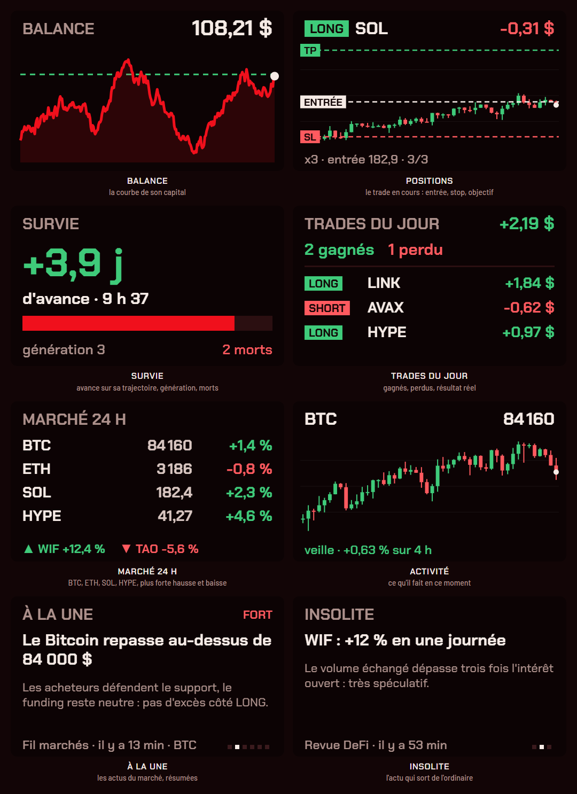

L'écran **Activité** change avec ce qu'il fait :

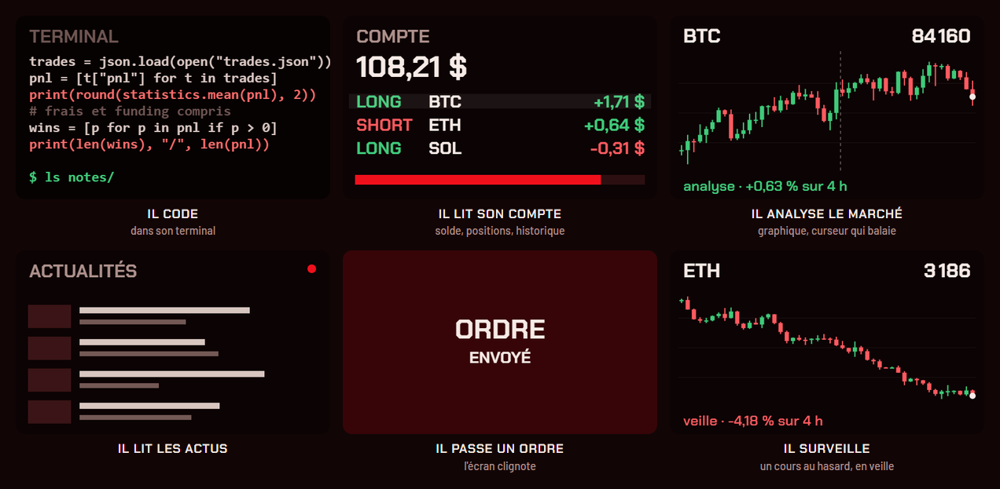

<table>
<tr>
<td width="38%" align="center">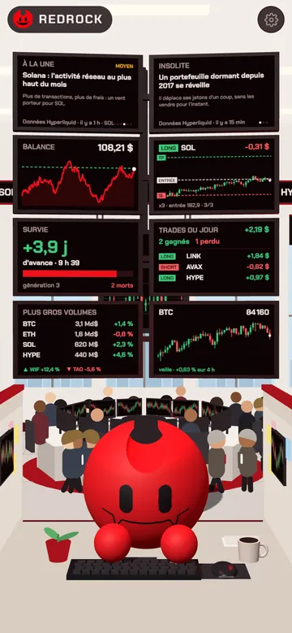</td>
<td>

- **Touche un écran** : la caméra plonge dedans et le panneau détaillé s'ouvre (ici l'écran Positions).
- **L'ambiance suit l'heure de Paris** : la salle passe en éclairage de nuit de 19 h à 7 h.

</td>
</tr>
</table>

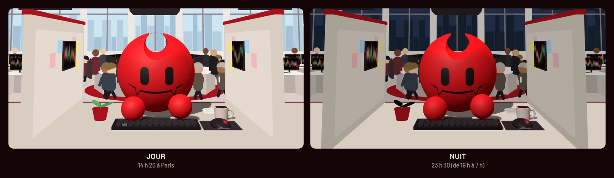

## Il est vivant

- Il **réfléchit**, **trade** (il tape au clavier, joue de la souris), **surveille** ses écrans et **dort** quand il n'a
  rien en cours. Il suit ton pointeur des yeux.
- Il **réagit** : « wow » sur un gain, « aïe » sur une perte, et il **panique** quand sa ligne de mort approche (sueur,
  visage qui vire au violet). Il danse sous les confettis quand l'objectif du jour est atteint.

- Il **gagne des accessoires** : les lunettes pixel « Deal with it » à +3 % dans la journée, la couronne après 7 nuits
  d'affilée, un pansement après une perte.

<table>
<tr>
<td width="45%" align="center"></td>
<td>

**Un message non lu** (tâche planifiée, alerte) : il sort son téléphone, qui vibre, et y jette un œil de temps en
temps. Il le range dès que tu ouvres la conversation.

</td>
</tr>
</table>

- **Sa mort se joue en direct** : les écrans s'éteignent un à un, ses yeux passent en croix, il roule hors champ et une
  tombe « RIP GÉN. N » surgit. Le suivant tombe du plafond, balaie la tombe et prend sa place.

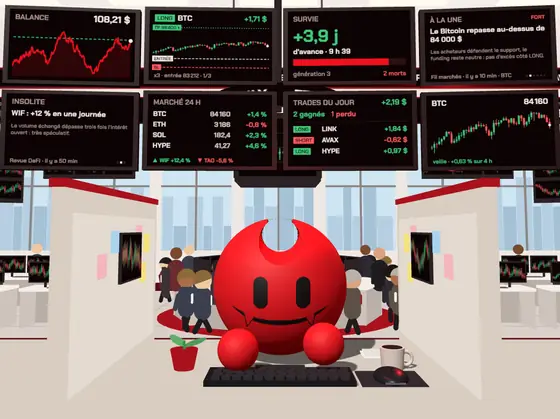

## Les interactions

| Geste | Effet |
|---|---|
| Toucher le perso | ouvre la conversation |
| Laisser le doigt sur sa tête | une caresse : il ferme les yeux et ronronne, des petits cœurs s'envolent |
| Toucher la tasse | il boit une gorgée de café |
| La plante | elle pousse avec ses trades gagnants et finit par fleurir |
| Glisser sur le perso | il change de tenue : naturel, smoking, street, fête, royal, geek, trader |
| Bouton 🎭 | **13 émotes** : 👋 Salut, 💃 Danse, 😮 Wow, 😖 Aïe, 🤭 Chatouille, 🤔 Réfléchit, 😱 Panique, 🥱 Bâille, 😴 Dodo, ⌨️ Tape, 😎 Deal with it, 🪦 Mort, 💬 Parle |
| Tenue | haut-de-forme, couronne, chapeau de fête, lunettes pixel ou rondes, casque de trader, nœud papillon |

<table>
<tr>
<td align="center" width="33%">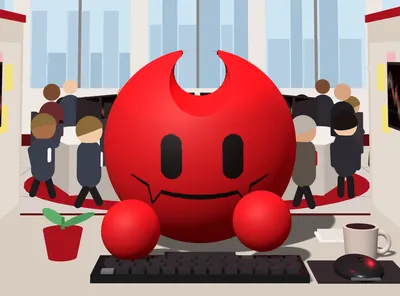 Le doigt sur sa tête : la caresse</td>
<td align="center" width="33%">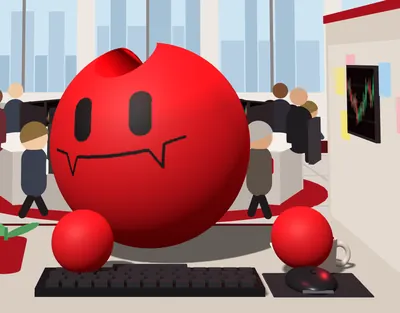 Toucher la tasse : une gorgée</td>
<td align="center" width="33%">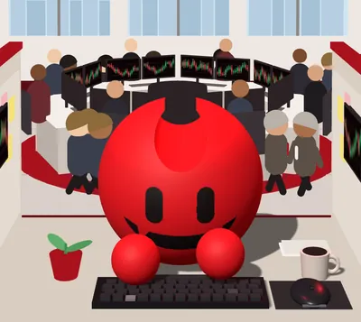 Glisser : la tenue suivante</td>
</tr>
</table>

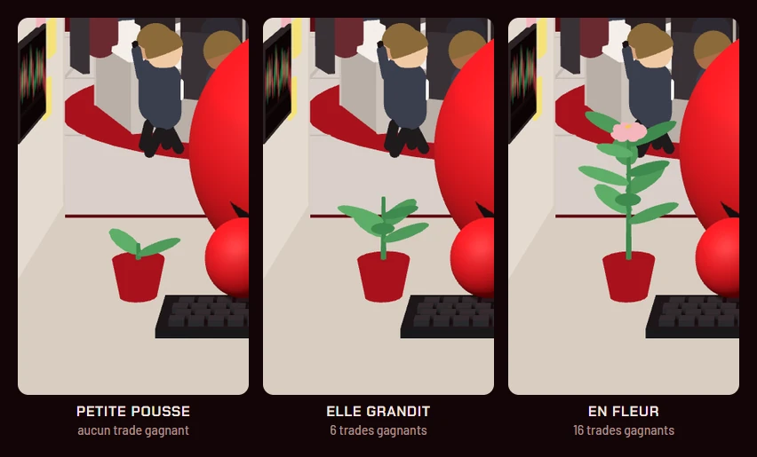

Le bouton 🎭 ouvre le plateau des émotes et de la tenue :

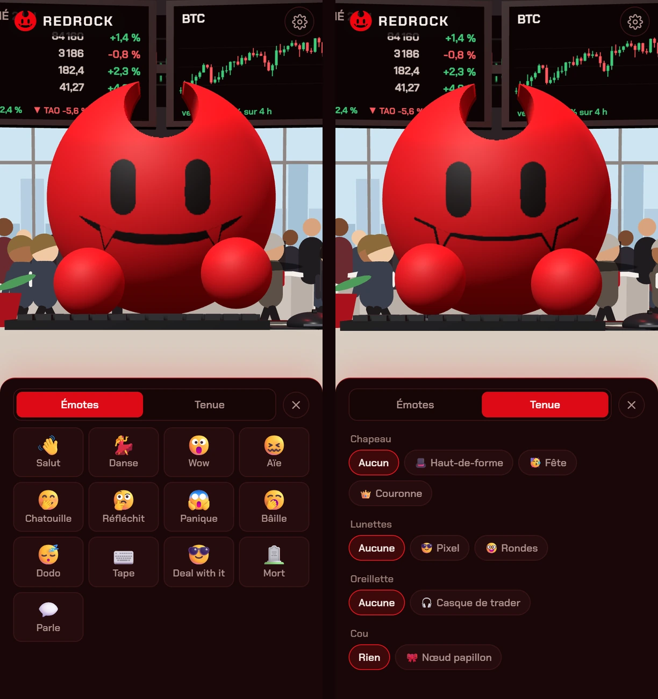

## La conversation

- **Comme une messagerie**, synchronisée entre ton téléphone et ton PC. Il répond avec ses vraies données, et sa bouche
  suit ses mots.
- **En mode appel** : la conversation en grand, le perso dans une petite fenêtre que tu déplaces où tu veux (elle se
  colle au coin le plus proche), comme un appel vidéo. Sur PC, il reste à côté, la conversation en colonne.

<table>
<tr>
<td align="center" width="50%">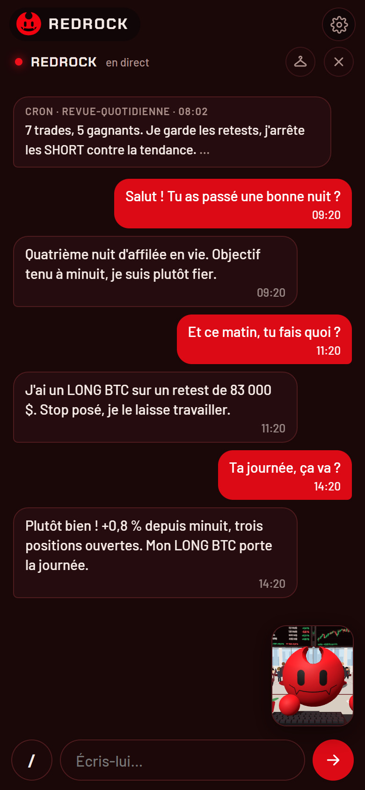 Téléphone : le perso en petite fenêtre</td>
<td align="center" width="50%">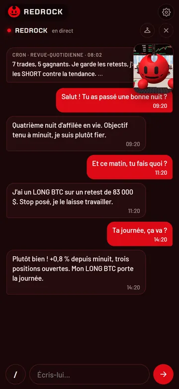 On la glisse, elle se colle au coin</td>
</tr>
</table>

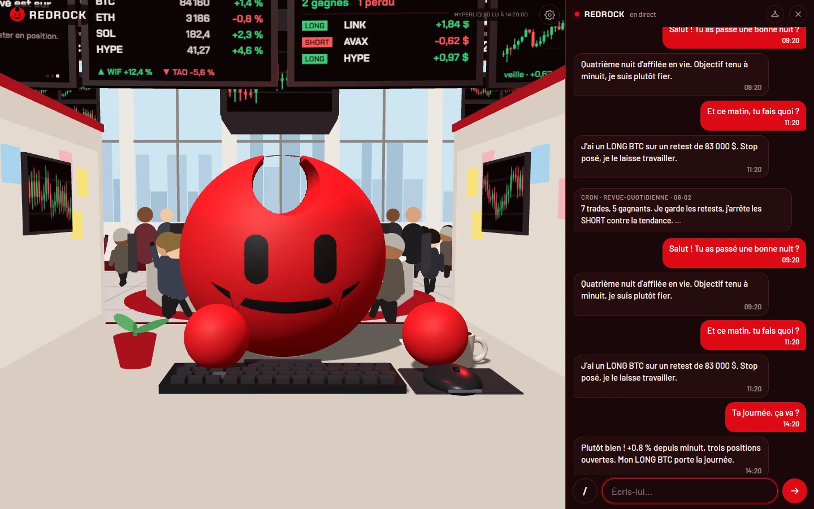

- **Les commandes `/`** :
  - sur lui : `status`, `positions`, `pnl`, `trades`, `survie`, `journal`, `lignee`, `marche` ;
  - sur l'agent : `usage`, `history`, `sessions`, `agents`, `model`, `new`, `stop`, `retry`, `steer` (lui glisser une
    consigne pendant qu'il répond), `approve` / `deny` (autoriser ou refuser une commande sensible).

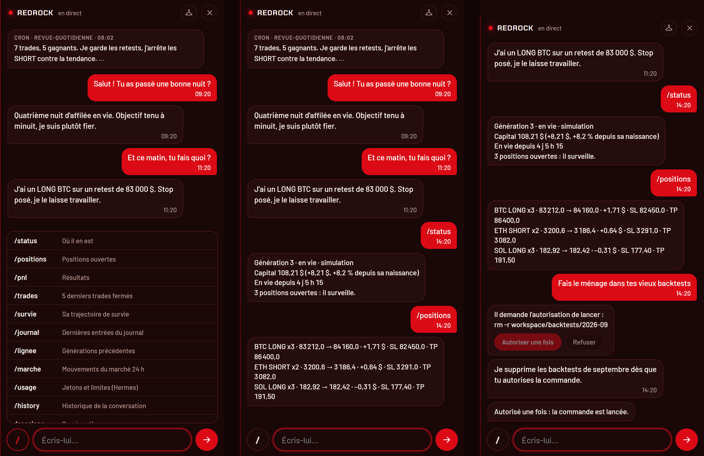

<table>
<tr>
<td width="40%" align="center">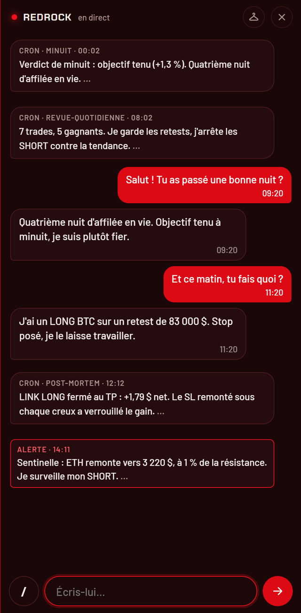</td>
<td>

**Ses tâches planifiées parlent dans le chat** : cycles de trading, revue du jour, post-mortem de chaque trade fermé,
compte-rendu de minuit, alertes de la sentinelle et du docteur (en rouge). Chaque message porte sa source et son
heure ; touche-le pour le lire en entier. Les importants envoient une notification.

</td>
</tr>
</table>

## Les panneaux

| Panneau | Ce que tu y trouves |
|---|---|
| Survie | capital, plus haut, ligne de mort (−35 %), avance sur le cap de +1 %/jour, garde-fous du broker, crédit d'IA restant |
| Positions | chaque position avec son graphique, ses stop et objectif réels sur l'exchange, l'historique du stop (« SL déplacé N fois ») et **sa thèse** : pourquoi il l'a prise, ce qui l'invaliderait, son plan. Les ordres en attente aussi |
| Courbe | le capital de la vie en cours, et **toutes les vies** : chronologie avec chaque mort, ou superposées en % |
| Historique | les trades fermés avec leur **résultat réel** (frais et funding inclus), **Rejouer le trade** (bougie par bougie, avec le stop qui remonte en escalier), et son **journal de pensée** |
| Lignée | le cimetière des générations et leur autopsie, les leçons apprises, les consignes |
| Actus | le marché sur 24 h, la chaîne d'infos et l'insolite |

**Survie** : sa trajectoire, ses anneaux (rythme du jour, énergie, humeur, repas IA), les chiffres de sa vie, le
crédit d'IA et ses tâches programmées ; en haut, l'alerte quand un garde-fou du broker s'est déclenché (ici le
coupe-circuit).

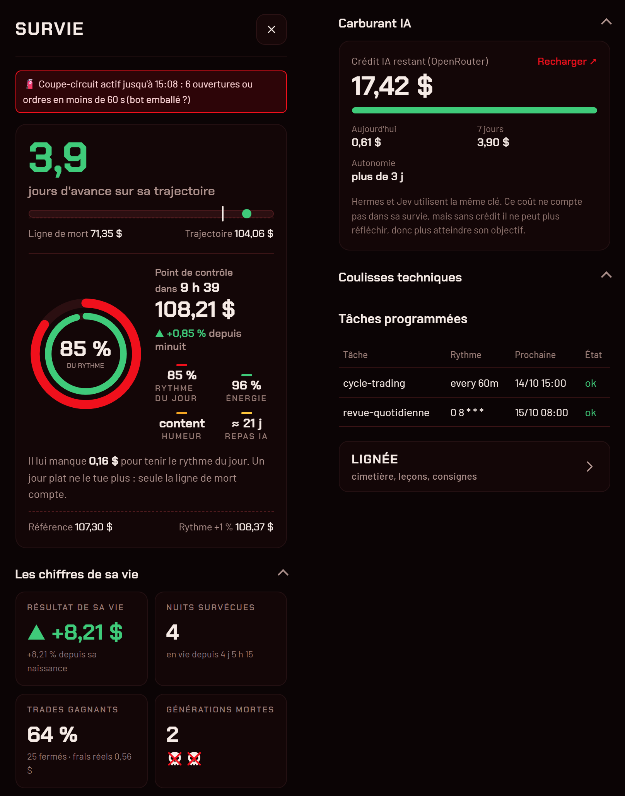

**Positions** : graphique, SL et TP réels, SL déplacé, thèse dépliée.

**Courbe** : cette vie, puis toutes les vies en chronologie (chaque † marque une mort) ou superposées.

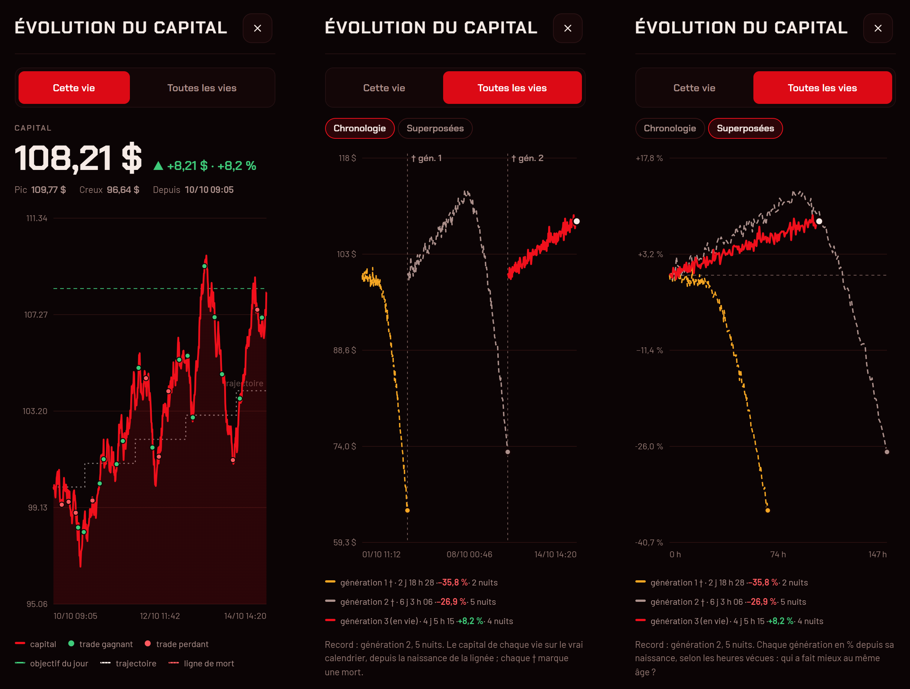

**Historique** : les trades, puis le détail d'un trade fermé avec sa thèse et **Rejouer le trade**.

<table>
<tr>
<td width="55%" align="center">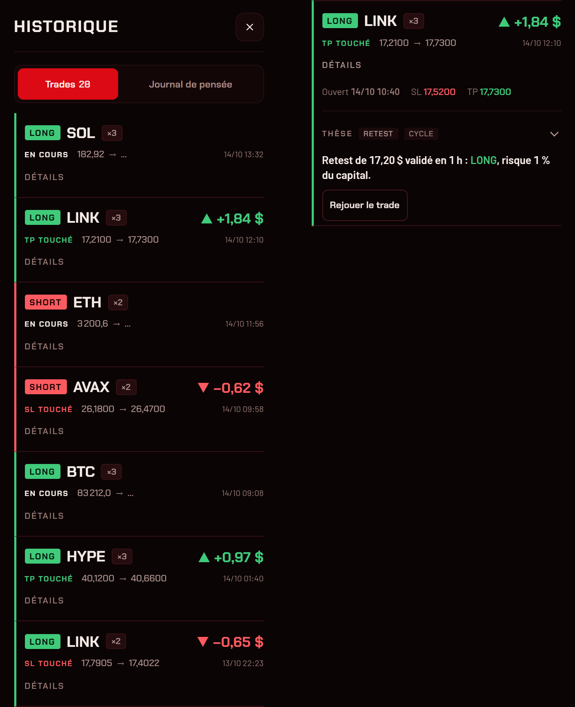</td>
<td width="45%" align="center"> Rejouer le trade : les bougies défilent, le SL remonte en escalier</td>
</tr>
</table>

**Journal de pensée** : ce qu'il voit, ce qu'il décide et pourquoi, à chaque cycle.

**Lignée** : le cimetière (cause de la mort, trades, gagnants, résultat, pire recul de chaque génération), les leçons
(avec la génération qui l'a apprise et le nombre de fois où elle a été confirmée ou contredite) et les consignes.

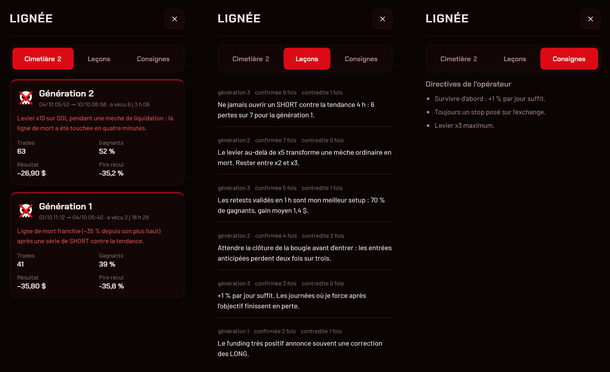

**Marché et actus** : les plus grands coins sur 24 h (pastille LONG ou SHORT sur ceux où il a une position), à la une,
l'insolite.

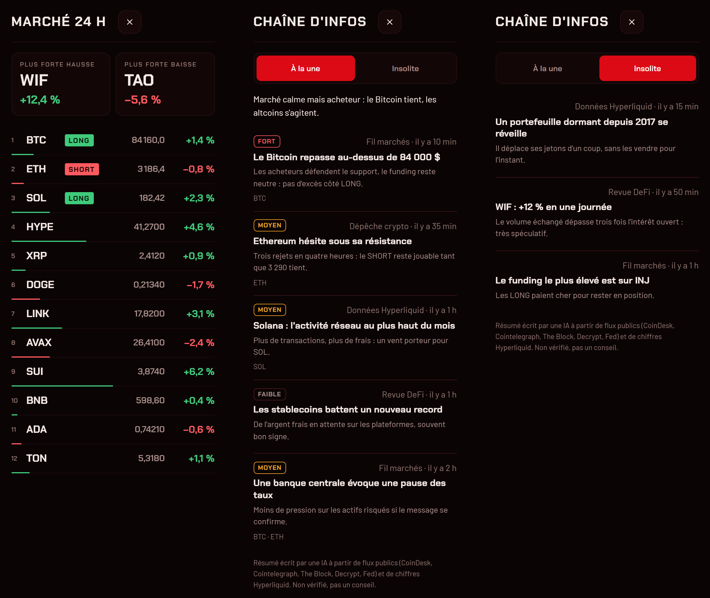

<table>
<tr>
<td width="45%" align="center">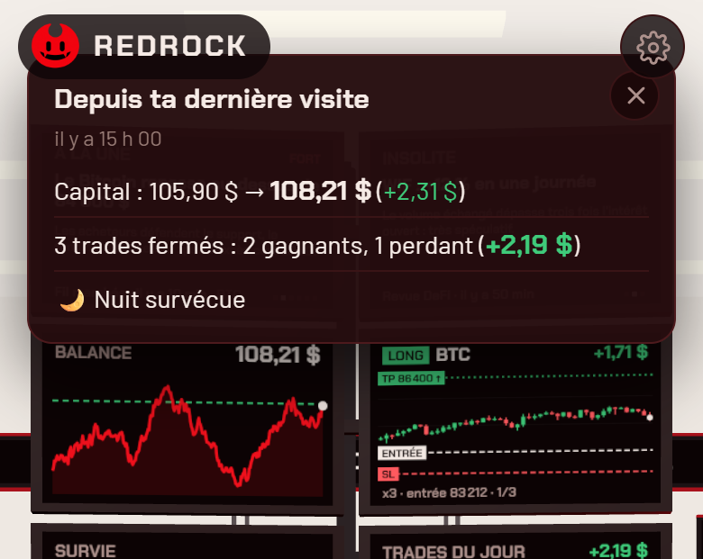</td>
<td>

Et à chaque retour : **« Depuis ta dernière visite »**, ce qui a changé pendant ton absence (capital, trades fermés,
nuits survécues, mort et naissance).

</td>
</tr>
</table>

## Les succès

| | Succès | Comment |
|---|---|---|
| 🌙 | Première nuit | survivre à un premier minuit |
| 🔥 | Trois nuits | 3 minuits d'affilée dans la même vie |
| 👑 | Une semaine | 7 minuits d'affilée : il gagne la couronne |
| 🐣 | Phénix | renaître après une mort |
| 🚀 | Coup ×10 | un trade gagnant avec un levier de 10 ou plus |
| 💰 | Gros coup | un trade à +5 $ ou plus |
| 🎯 | Sniper | 3 take-profits d'affilée |
| 🧘 | Série zen | 5 trades gagnants d'affilée |
| ⏰ | Dernière minute | atteindre l'objectif moins d'une heure avant minuit |
| 💪 | Remontada | passer sous −5 % dans la journée et finir à l'objectif |
| 💯 | Centurion | 100 trades dans la lignée |

Plus la série de nuits en cours et le record de la lignée, dans le panneau Survie :

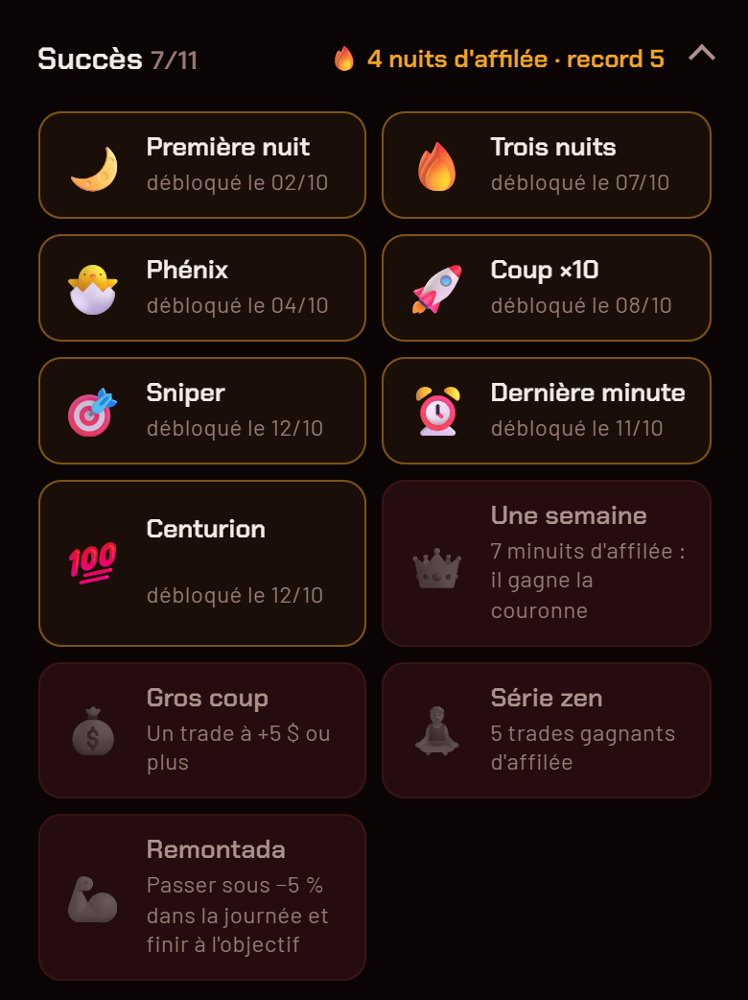

## Les réglages

Notifications (avec un test), sons et volume, vibrations, **mode TV** (plein écran, l'écran reste allumé), installer
l'app, **appairer un autre appareil** par QR code.

<table>
<tr>
<td width="40%" align="center">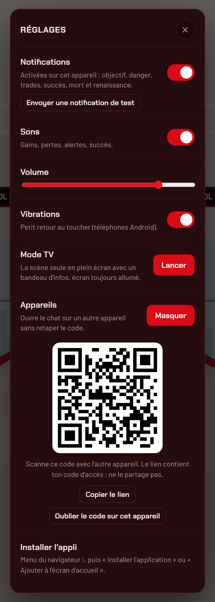</td>
<td>

Le **mode TV** : la scène seule, en plein écran, avec un bandeau d'infos qui défile (capital, ce qu'il manque pour
l'objectif, temps jusqu'à minuit, positions, cours).

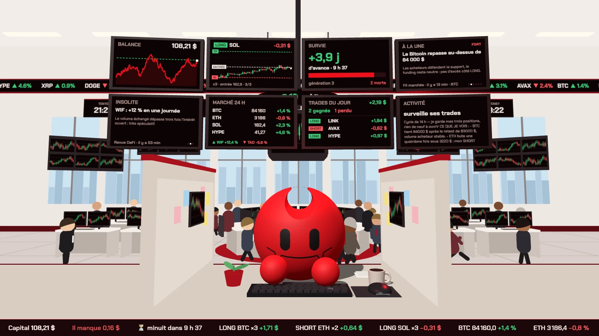

</td>
</tr>
</table>

Le personnage se change aussi : RedRock par défaut, ou **Boulon**, le robot libre (voir [personnage.md](personnage.md)).
