# Le personnage : RedRock, Boulon ou le tien

Le dashboard ne dépend d'aucun personnage en particulier : il charge un module qui respecte un contrat. Deux sont
fournis :

| Personnage | Dossier | Licence |
|---|---|---|
| **RedRock**, la boule rouge (par défaut) | `dash/character/` | [PolyForm Noncommercial 1.0.0](../dash/character/LICENSE) : usage **non commercial** |
| **Boulon**, le petit robot à écran | `dash/character-libre/` | [MIT](../dash/character-libre/LICENSE) : usage libre, **y compris commercial** |

<table>
<tr>
<td align="center" width="50%">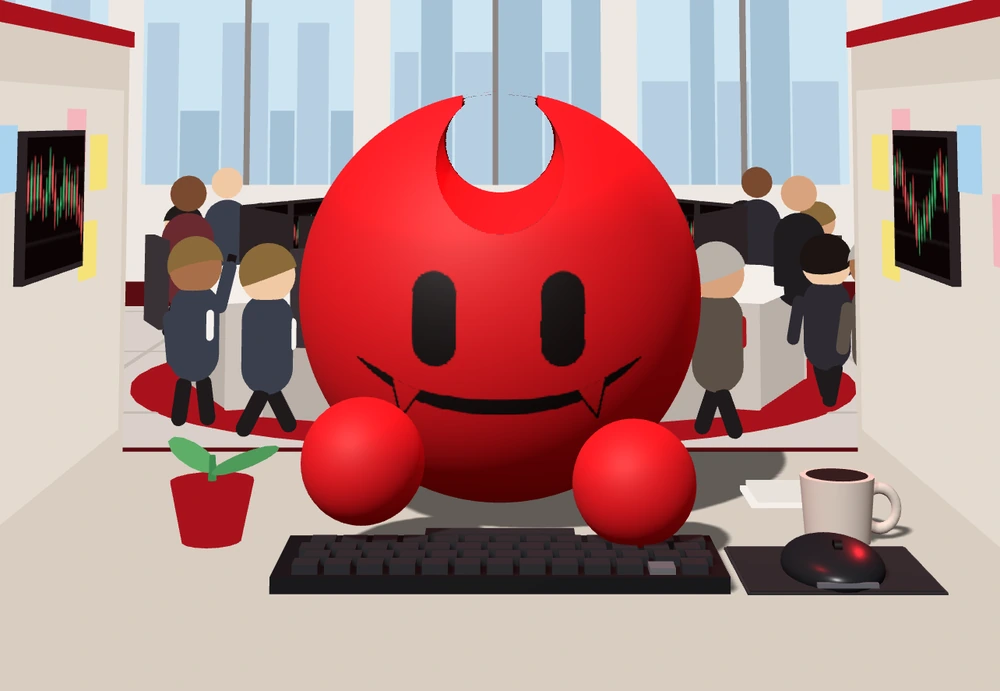<br><b>RedRock</b></td>
<td align="center" width="50%">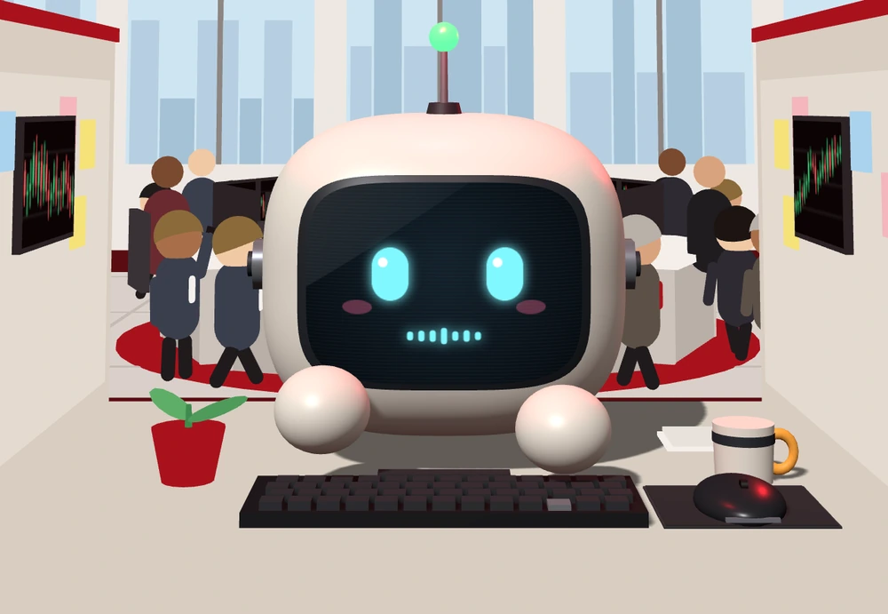<br><b>Boulon</b></td>
</tr>
</table>

Boulon fait tout ce que fait RedRock : trading, réflexion, sommeil, panique, danse, téléphone, café, tenues, scène de
mort et de relève. Pour un usage commercial, prends Boulon (ou ton propre personnage).

*Les fiches ci-dessous sont des captures de l'app (données de démonstration). Comme tous les médias de `docs/media/`,
ces images sont sous [CC BY-NC 4.0](../LICENSES.md), quelle que soit la licence du code du personnage.*

## Fiche : RedRock

**Tour de tête** : il tourne la tête vers ce qu'il regarde (ses écrans, ton pointeur).

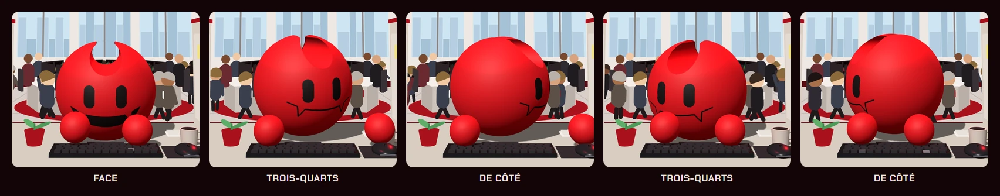

**Humeurs** : elles suivent son état réel (activité, gains et pertes, distance à la ligne de mort, objectif du jour).

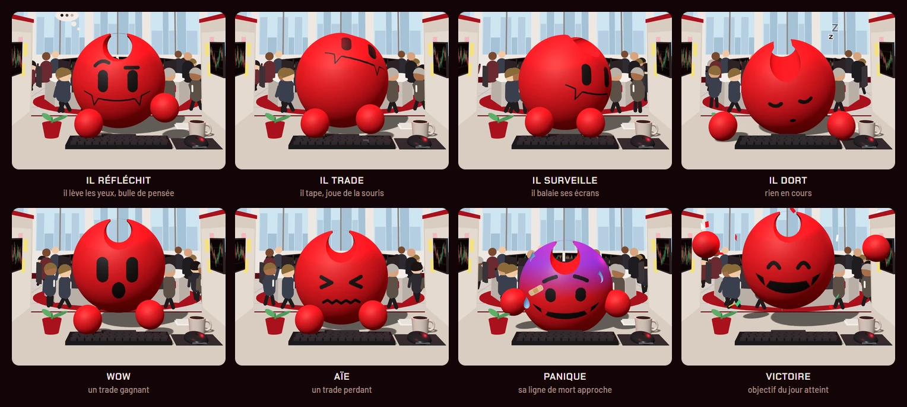

**Les 13 émotes** du bouton 🎭 :

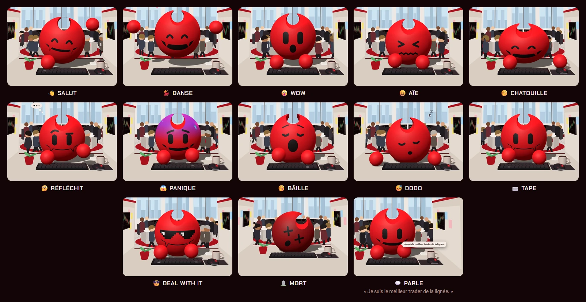

**Tenues** : chaque pièce seule, puis quelques combinaisons (chapeau, lunettes, oreillette et cou se cumulent).

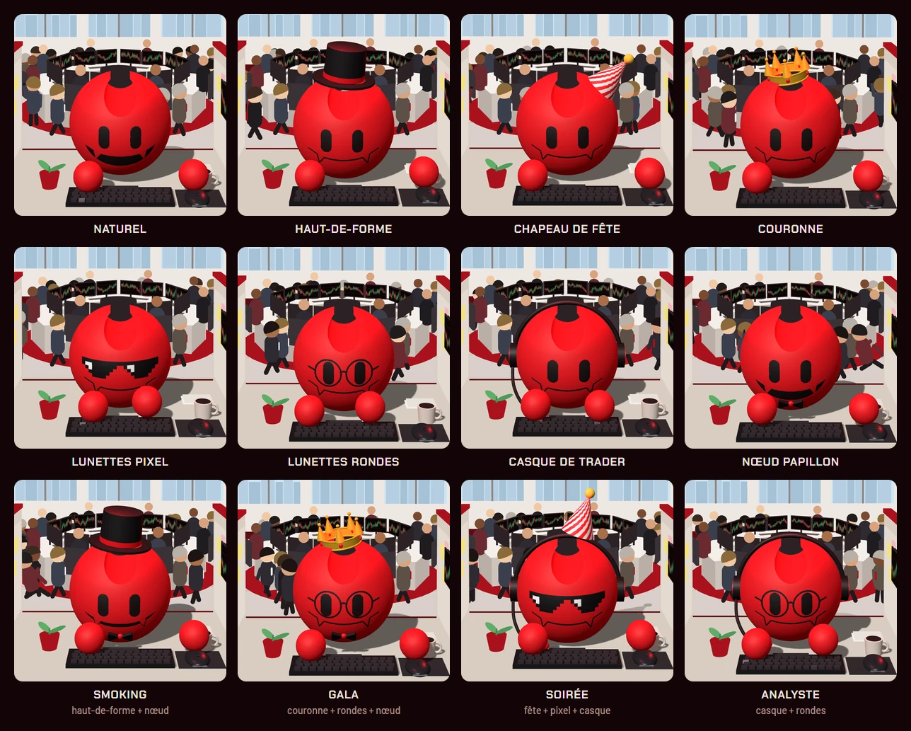

**Accessoires gagnés** : ils viennent de ses vrais résultats, pas de la garde-robe.

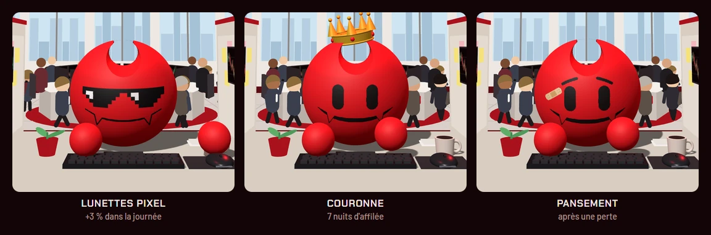

<table>
<tr>
<td width="45%" align="center">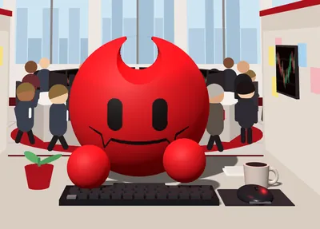</td>
<td><b>Téléphone</b> : un message non lu, il le sort, le regarde, il vibre de temps en temps.</td>
</tr>
</table>

**Mort et relève** :

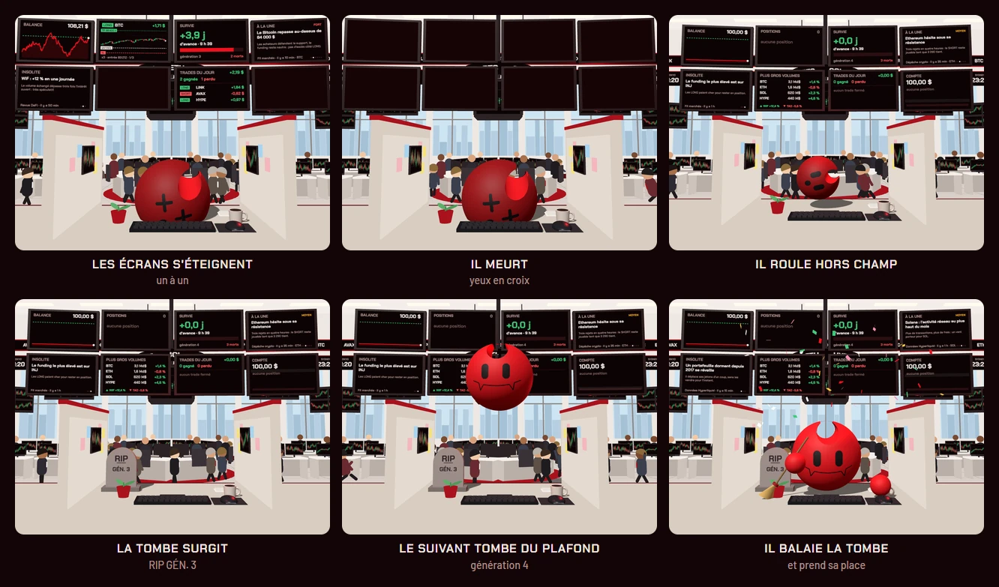

## Fiche : Boulon

**Tour de tête** :

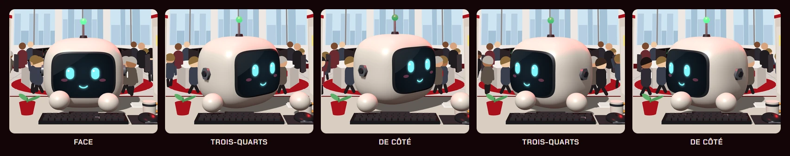

**Humeurs** : les yeux et la bouche s'affichent sur son écran ; quand il panique, ils virent à l'orange.

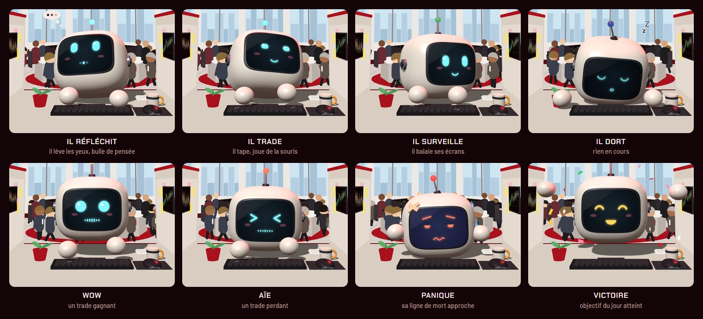

**Les 13 émotes** :

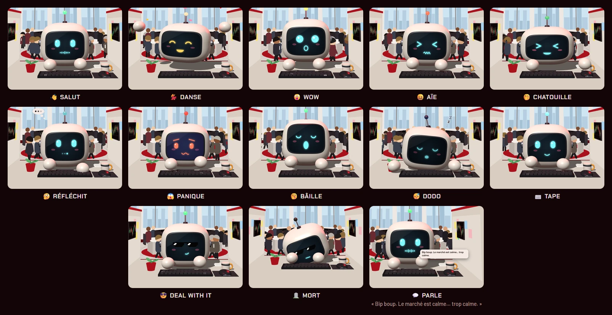

**Tenues** :

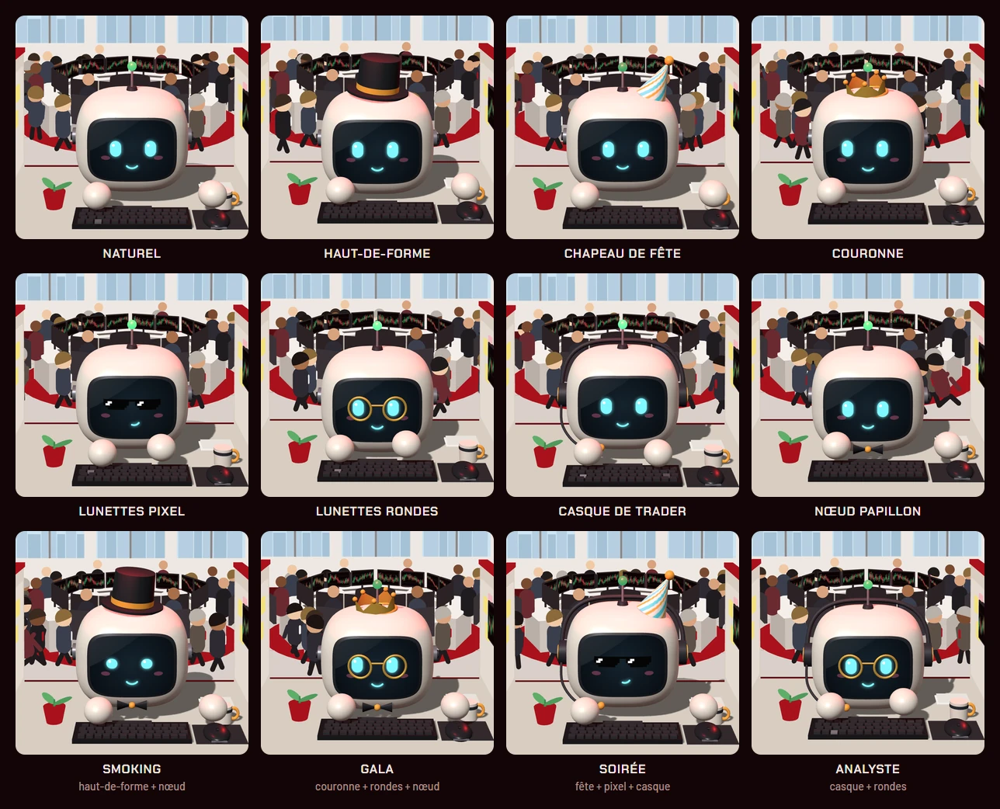

**Accessoires gagnés** (le pansement se colle en croix sur un coin de son écran) :

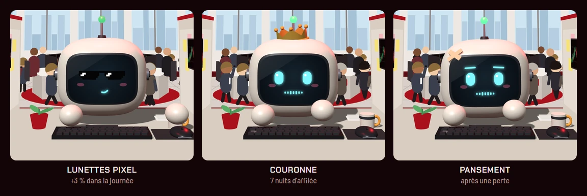

<table>
<tr>
<td width="45%" align="center">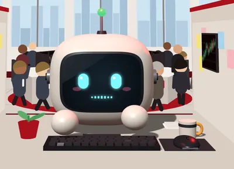</td>
<td><b>Téléphone</b> : même geste que RedRock.</td>
</tr>
</table>

**Mort et relève**, à sa façon : son écran s'éteint comme une vieille télé, un rayon descend du plafond et l'aspire ;
le suivant descend dans le rayon, démarre comme un ordinateur (« BOOT », puis le numéro de sa génération) et ouvre
les yeux.

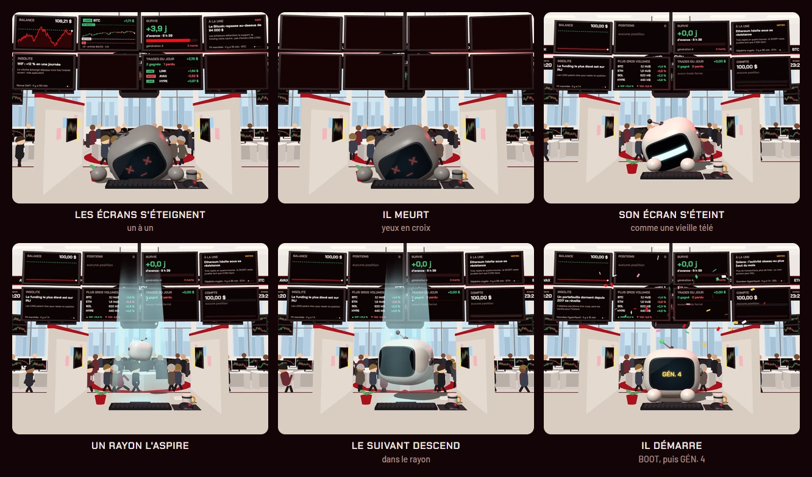

## Changer de personnage

| Comment | Effet |
|---|---|
| ajoute `CHARACTER=libre` dans `config/redrock.env`, puis `docker compose up -d dash` | Boulon pour tous les appareils |
| ouvre l'app avec `?perso=libre` (ou `?perso=redrock`) | essai dans cet onglet seulement |
| supprime le dossier `dash/character/` | Boulon automatiquement : l'image Docker, l'app et le mode hors ligne s'en passent |

Sans réglage, l'app prend RedRock s'il est présent, sinon Boulon.

## Écrire le tien

Le plus simple : pars de Boulon, qui est sous MIT.

1. Copie `dash/character-libre/` (par exemple en `dash/character-libre/monperso.js`) et modifie le modèle 3D,
   le visage, les répliques.
2. Dans le `<script type="module">` de `dash/index.html`, fais pointer la fonction `libre` vers ton fichier
   (`import("./character-libre/monperso.js")`), puis choisis le perso libre (`CHARACTER=libre`).
3. Ajoute le fichier au `SHELL` de `dash/sw.js` (mode hors ligne).

Le serveur sert tous les `.js` de `dash/character/` et de `dash/character-libre/`.

## Le contrat

La référence complète (ce que la scène fournit, l'ordre des appels à chaque image, l'état `S`, ce que le
personnage doit exposer) est dans **[dash/character-libre/README.md](../dash/character-libre/README.md)**.

En résumé :

```js
export function createCharacter({THREE, rig, desk, renderer}) {
  const head = new THREE.Mesh(/* … */), none = () => new THREE.Group();
  rig.add(head);
  return {
    head, HEAD: head.position.clone(), HS: 1,        // la caméra, les bulles et le toucher s'en servent
    // obligatoire : la scène clone ces modèles pour la vitrine de la garde-robe (des groupes vides suffisent)
    outfit: {crown: none(), topHat: none(), partyHat: none(), bowTie: none(), makeHeadset: none},
    hatchT: -1, partyUntil: 0,
    mount({props, hitZone}) {},                       // une fois le bureau posé
    update(dt, now, t, S) {                           // chaque image
      // anime la tête selon S.act, S.alive, S.talking, S.unread…
      S.em = null;                                    // obligatoire : renvoyer l'état résolu
    },
    updateHands(dt, now, t, S) {}, lateUpdate(dt) {},
    hatch() {}, party(ms) {}, emote(name) {}, tap(sleeping) {}, line(kind) { return ""; }, sip() {},
    debug: {benchFace() {}, liveTexels: 0}, dispose() { rig.remove(head); },
  };
}
```

Les fonctions dont ton personnage n'a pas besoin peuvent ne rien faire. Deux obligations : `outfit` contient les
cinq modèles ci-dessus, et `update()` recopie dans `S` les champs `act`, `win`, `danger`, `task` et `em` (au besoin
tels quels, `em` à `null`).

## Vérifier

Ouvre l'app avec `?render=force` (et `&perso=libre` pour Boulon) et, dans la console du navigateur :
- `__emote("dance")`, `__emote("panic")`, `__emote("shades")` : les émotes ;
- `__unreadT(2)` : il sort son téléphone ;
- `__outfit = {hat: "top", neck: "bow"}` : une tenue ;
- `__hatch()` : la scène de mort et de relève.
